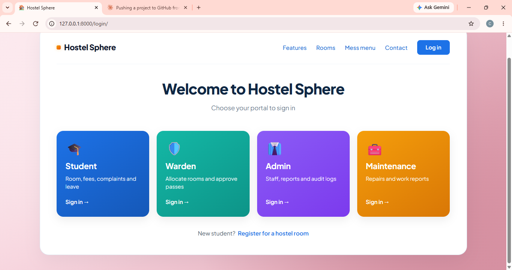

# Hostel Sphere

Integrated Smart Hostel Management System built with Django.

## Features
- Role-based login: Student, Admin, Warden, Maintenance
- Student registration and room/bed allocation (with gender separation)
- Fees and receipts with installments, paid and pending amounts
- Gate pass (check-in / check-out) with warden and admin approval
- Complaints and maintenance tracking
- Leave requests and visitor management
- Mess / food management
- Notifications and role-specific dashboards
- Audit logs and recycle bin (soft delete and restore)

## Tech Stack
- Backend: Django (Python)
- Database: SQLite (default) or MySQL
- Frontend: HTML, CSS, JavaScript

## Setup
1. Clone the repository
   git clone https://github.com/chithrashivannatd-sudo/Hostel-sphere.git
   cd Hostel-sphere
2. Create and activate a virtual environment
   python -m venv .venv
   .venv\Scripts\activate
3. Install dependencies
   pip install -r HOSTELSPHERE/requirements.txt
4. Create your environment file
   copy .env.example .env
5. Run migrations and start the server
   python manage.py migrate
   python manage.py runserver
6. Open http://127.0.0.1:8000/

## Authors
- Chithra T S
- Annapurna L

   ## Screenshots
   
